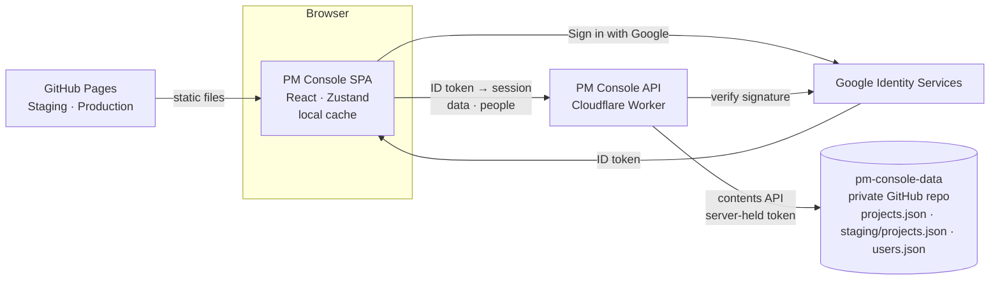

# PM Console — High-level specification

|             |                                                                                                            |
| ----------- | ---------------------------------------------------------------------------------------------------------- |
| Status      | Living document — describes the console as built                                                           |
| Last update | 23 October 2026                                                                                            |
| Production  | https://artemiivarta.github.io/pm-console-app/                                                             |
| Staging     | https://artemiivarta.github.io/pm-console/                                                                 |
| Source      | [ArtemiiVarta/pm-console](https://github.com/ArtemiiVarta/pm-console) (user guide and setup in the README) |

## 1. Purpose

PM Console helps a project manager plan and monitor SAP-style consulting engagements: define projects and their schedules, forecast team effort, cost, revenue and margin, freeze agreed forecasts as baselines, and see the whole portfolio at a glance. A small team signs in with Google and works on the same, always-synced set of projects.

**In scope today:** portfolio overview, project details and status, schedule (Gantt), team forecast and allocation, baselines, people and roles, sync, backup.
**Not yet built:** Planning, Monitoring, Reports, and actuals for Forecast vs Actual (tabs exist as placeholders).

## 2. Users and roles

| Role      | Who                                         | Can                                                                 |
| --------- | ------------------------------------------- | ------------------------------------------------------------------- |
| **Owner** | `OWNER_EMAIL` on the API (vvarta@gmail.com) | Everything an admin can; always an admin; cannot be removed         |
| **Admin** | Added on the Admin tab                      | Use the console; see the **Admin** tab; add, re-role, remove people |
| **User**  | Added on the Admin tab                      | Use the console (all projects); no Admin tab                        |

- Anyone else who signs in with Google is refused (“doesn’t have access, ask an admin”).
- Every signed-in person sees and edits all projects; there is no per-project permission yet.
- Role changes and removals take effect within about 30 seconds, including for people already signed in.

## 3. Environments

|                      | Staging                               | Production                                   |
| -------------------- | ------------------------------------- | -------------------------------------------- |
| Purpose              | Feature testing                       | Real projects                                |
| URL                  | `/pm-console/`                        | `/pm-console-app/`                           |
| Updated              | Automatically on every push to `main` | Manually: **Actions › Deploy to Production** |
| Marker               | “Staging” badge and page title        | none                                         |
| Project data         | `staging/projects.json`               | `projects.json`                              |
| Browser storage keys | `pm-console-*`                        | `pm-console-prod-*`                          |

- Both sites share the same API, the same people list and the same Google sign-in.
- Production always ships a version that already passed on Staging (by default the last successful Staging deploy; any earlier commit can be chosen to roll back).
- `npm run dev` adds a **local test mode** (Test admin / Test user, in-browser stand-in API and data) that is never included in Staging or Production builds.

## 4. Architecture



| Part            | Technology                                                                                                             | Responsibility                                                                                   |
| --------------- | ---------------------------------------------------------------------------------------------------------------------- | ------------------------------------------------------------------------------------------------ |
| Web app         | Vite, React 18, TypeScript (strict), Tailwind, shadcn/ui (Radix), Zustand, date-fns, zod + react-hook-form, HashRouter | All UI and business calculations; keeps a local copy of the workspace; syncs it                  |
| API (`/worker`) | Cloudflare Worker, Web Crypto only                                                                                     | Verifies Google ID tokens, issues sessions, enforces roles, reads and writes the data repository |
| Data store      | Private GitHub repository `pm-console-data`                                                                            | One JSON file per environment, plus the people list; full version history                        |
| Hosting         | GitHub Pages (Staging from this repo; Production from `pm-console-app`, branch `gh-pages`)                             | Static files only — no data                                                                      |

Business logic lives in pure, unit-tested functions under `src/lib`; UI conventions are in [CLAUDE.md](../CLAUDE.md).

## 5. Functional specification

### 5.1 Sign-in and session

- **Sign in with Google** (official button, One Tap for returning people). The API verifies the Google token and checks the person’s role.
- A session lasts **30 days** per browser and is shared by Staging and Production; the role is re-checked on every request and refreshed on each app load.
- **Log out** first saves unsaved changes (asks before losing any), then clears the session and this browser’s copy of the projects, and stops Google auto sign-in.
- Logging in or out in one tab applies to the browser’s other tabs. Signing in as a different person clears the previous person’s cached projects.
- An expired or revoked session returns to the sign-in page with an explanation.

### 5.2 Projects (home page)

- **Treemap** of all projects: tile area ∝ forecast revenue (converted to a reporting currency when projects use different currencies; a minimum size keeps zero-revenue projects visible), tile colour = status (Green / Amber / Red), with name, client, revenue and status.
- **Exchange rates** dialog for the reporting currency (saved per browser).
- **All projects** table with status, rationale, revenue, margin %, dates; open and delete (with confirmation).
- **New project** creates an empty project and opens its General tab. Clicking a project opens its Project Settings.

### 5.3 Project Settings › General

- Name (required), client, **status** (Green default, Amber, Red) with optional **rationale** (≤ 500 characters), currency (CAD, USD, EUR, GBP), standard hours per week (= 100 % load), and how phase days count (working Mon–Fri or calendar).
- Summary tiles: start, end, duration (working days), team size, forecast hours, margin.
- Leaving with unsaved edits asks to save, discard or keep editing; closing the tab warns.

### 5.4 Project Settings › Project Schedule (Gantt)

- Hierarchy: **phase › task › sub-task**, with **milestones** (★) at every level and **project milestones**.
- Add from the toolbar (**Add › Phase / Task / Sub-task / Milestone**, with an “Under” picker) or a row’s **+** / **⋯** menu; edit, recolour, delete (confirmed).
- Drag a bar to move it (children move along), drag its edges to change start or end, drag stars to move milestones; keyboard equivalents (←/→, Shift+←/→, Alt+←/→).
- **Adjust start/end to children**: a parent can follow its children (start = earliest child start, end = latest child end), kept in sync automatically.
- Durations in days or weeks, or a pinned end date; overlap and gap warnings between phases; collapse/expand; today marker.

### 5.5 Project Settings › Team Forecast

- **Team members:** name, email, role, start date, allocation % (0–200), developer capacity % (0–100), cost and price rates, active flag. Margin per hour previewed. Sorting, role filter, **Show/Hide financials**.
- **Planned allocation grid:** per person per week, in load % or hours; phase bands; partial weeks marked; overallocation warnings; keyboard editing; range selection with bulk Set / Reset / Fill right; weekly totals. Edits are pending (dashed outline) until **Save changes** (Ctrl+S) or **Discard**.
- **Totals:** planned hours, development capacity, cost, revenue, margin, margin %.

### 5.6 Baselines (versions)

- **Create baseline** freezes a locked snapshot of project, phases and team with its totals.
- View read-only, compare any two versions (per member), restore, and choose the baseline used by Forecast vs Actual. A badge shows when the forecast changed since the last baseline.

### 5.7 Admin (admins only)

- Add a person by Google email with role **User** or **Admin**; change roles; remove access (confirmed). Duplicate and invalid emails are rejected.
- The owner is listed as **Owner · Admin** and cannot be changed or removed.
- The tab is hidden from users, and the route redirects them to Projects; the API refuses people management to non-admins regardless of the UI.

### 5.8 Sync

- Always on while signed in; no setup per computer.
- Saves about **1.5 s** after each change, and immediately when the tab is hidden or closed; checks for others’ changes on focus and every **15 s**; tabs in one browser stay in step.
- Optimistic concurrency: each save names the version it replaces. If someone else saved first and this browser has unsaved changes, a dialog offers **Keep this computer’s** / **Use GitHub’s** / **Later**; otherwise the newer version is taken silently.
- The top-bar cloud icon shows Saved / Saving / Checking / Problem / Conflict, with details and **Sync now**.

### 5.9 Backup

- **Export** downloads every project as one JSON file; **Import** validates it (schema and version) and replaces all projects after confirmation. Older single-project backups are accepted.

### 5.10 Placeholders

- **Planning, Monitoring, Reports:** “coming soon”.
- **Forecast vs Actual:** baseline selection only; actuals are not captured yet.

## 6. Business rules

| Rule                 | Definition                                                                                                                                                                 |
| -------------------- | -------------------------------------------------------------------------------------------------------------------------------------------------------------------------- |
| Project dates        | Start = earliest phase start; end = latest phase end; duration in working days                                                                                             |
| Phase / task end     | Pinned end date if set (never before the start), otherwise from the duration: weeks = 7 calendar days each; days = calendar days, or the n-th weekday in working-days mode |
| Weekly load          | 0 % for weeks ending before the member’s start date; otherwise the week’s override, else the member’s allocation                                                           |
| Week share           | Fraction of the week’s Mon–Fri days that fall inside the project and on/after the member’s start date (partial weeks pro-rated)                                            |
| Hours                | load % / 100 × standard hours per week × week share                                                                                                                        |
| Development capacity | hours × capacity % / 100                                                                                                                                                   |
| Cost / Revenue       | hours × cost rate / hours × price rate                                                                                                                                     |
| Margin, margin %     | revenue − cost; margin / revenue (0 when revenue is 0)                                                                                                                     |
| Team totals          | Sum over **active** members only                                                                                                                                           |
| Overallocation       | A week above 100 % load is flagged                                                                                                                                         |
| Treemap weight       | Revenue in the reporting currency, minimum 4 % of the largest; equal weights when all are 0                                                                                |

## 7. Data model

A **workspace** holds every project; each project carries all of its data.

```
Workspace { library: { [projectId]: ProjectData }, activeProjectId }

ProjectData
├── project      Project      id, name, client, status, statusRationale, currency,
│                             standardHoursPerWeek, durationMode, createdAt, updatedAt
├── phases       Phase[]      name, color, order, startDate, duration, durationUnit,
│                             endDate?, fitStart?, fitEnd?, notes?
├── items        ScheduleItem[]  tasks and milestones under a phase or task (parentId, kind, …)
├── milestones   Milestone[]  project milestones: name, date, color
├── members      TeamMember[] name, email, role, defaultLoadPct, weeklyOverrides{week→%},
│                             capacityPct, startDate?, costRate, priceRate, active
├── baselines    ForecastBaseline[]  locked snapshot {project, phases, members} + totals
└── selectedBaselineId
```

- Stored file format (GitHub and backups): `{ format: "pm-console-backup", version, exportedAt, workspace }`. Version is migrated forward on load; newer versions are refused.
- People list (`users.json`): `{ users: [{ email, role, addedAt, addedBy }] }`; the owner is implicit.

## 8. API

Base URL `https://pm-console-api.artemiivarta.workers.dev`. All routes except sign-in need `Authorization: Bearer <session>`. CORS is limited to the console’s own origins.

| Method and path                                 | Who       | Purpose                                                                         |
| ----------------------------------------------- | --------- | ------------------------------------------------------------------------------- |
| `POST /auth/google` `{credential}`              | anyone    | Verify the Google ID token → `{token, expiresAt, user}`; 403 if not on the list |
| `GET /me`                                       | signed in | Current person and role                                                         |
| `GET /data/{staging\|production}`               | signed in | `{sha, text}` of that environment’s projects, or 404                            |
| `PUT /data/{staging\|production}` `{text, sha}` | signed in | Save; 409 if the file changed since `sha`                                       |
| `GET /users`                                    | admin     | `{owner, users}`                                                                |
| `PUT /users/{email}` `{role}`                   | admin     | Add or change a person                                                          |
| `DELETE /users/{email}`                         | admin     | Remove a person                                                                 |

Every data and people change is a commit in `pm-console-data` whose message names the person who made it.

## 9. Security and privacy

- **Authentication:** Google ID tokens verified on the server (signature, issuer, audience, expiry, verified email). Sessions are HMAC-signed by the API (secret `SESSION_SECRET`).
- **Authorisation:** role checked on every API request; the UI hides admin features but the API enforces them.
- **Secrets:** the only GitHub token is the API’s `GITHUB_TOKEN` (fine-grained, Contents read/write on `pm-console-data` only). No token, password or PIN is in the code or in browsers. The Google client ID and API URL are public by design.
- **Data:** never shipped with the site. Browsers keep a working copy (cleared on log out). See the [Privacy Policy](https://artemiivarta.github.io/pm-console/privacy.html) and [Terms](https://artemiivarta.github.io/pm-console/terms.html).
- **Deployment keys:** Production is published with a write-only deploy key (`PRODUCTION_DEPLOY_KEY`) scoped to `pm-console-app`.

## 10. Non-functional requirements

- **Accessibility:** fully usable by keyboard; every control has a label and tooltip; dialogs trap focus; errors are announced.
- **Look:** light and dark themes; design tokens and icon mapping per CLAUDE.md; usable from 1024 px wide.
- **Reliability:** local copy survives reloads and offline moments; unsaved changes are flagged and retried; conflicts are never resolved by silently discarding local edits.
- **Quality gates:** lint, strict type-check and the Vitest suite (≈ 250 app tests, plus API tests) run on every Staging deploy; Production re-runs the tests before publishing.
- **Performance:** pages load on demand; the sign-in screen ships in a small first bundle.

## 11. Known limitations and next steps

- No per-project access control; everyone signed in sees every project.
- Whole-workspace saves: two people editing at the same moment get a keep-mine / keep-theirs choice rather than a merge.
- Session revocation is by removing the person (within ~30 s); there is no “sign out everywhere” for a single session.
- The API’s GitHub token expires (fine-grained token, up to one year) and must be replaced with `wrangler secret put GITHUB_TOKEN`.
- Planned: Planning, Monitoring, Reports, and actual hours/costs for Forecast vs Actual.
